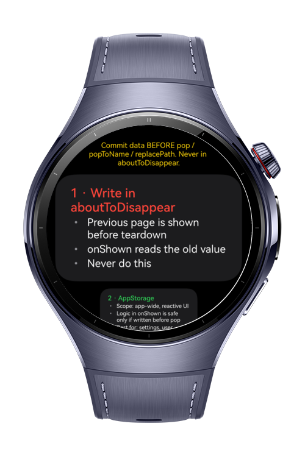
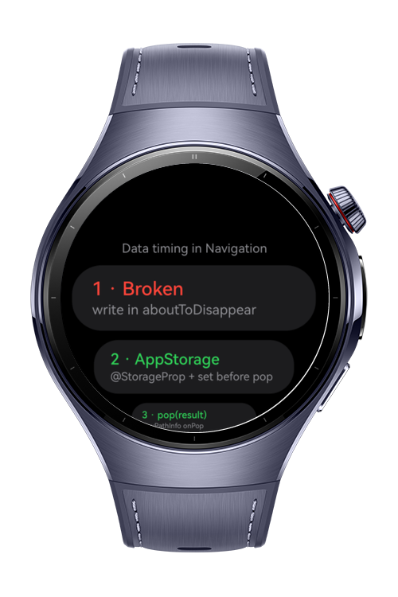
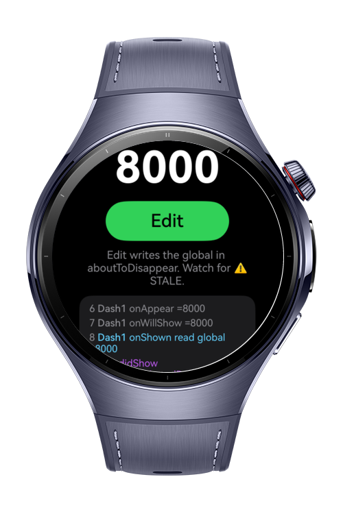
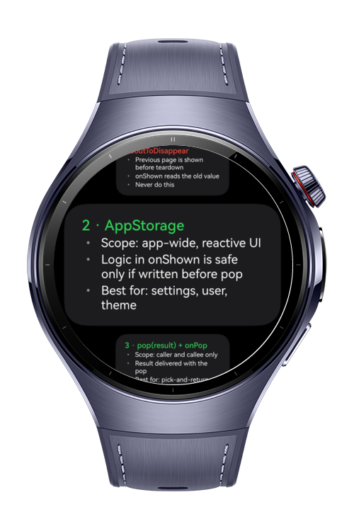

> **Note:** To access all shared projects, get information about environment setup, and view other guides, please visit [Explore-In-HMOS Index](https://github.com/Explore-In-HMOS/hmos-index).

# How to Manage Global Data During Navigation

A sample for HarmonyOS smart wearables that shows when to update shared data during `Navigation` transitions. When the user goes back from page B to page A, A is shown before B is torn down, so a value that B saves in `aboutToDisappear` reaches A too late and A shows the old value. The app builds the same "edit daily step goal" flow (Dashboard → Edit Goal → Review → Confirm) four ways: one broken on purpose and three correct ones. It logs every lifecycle callback on the watch in the order it really fires, so you can see the timing for yourself. The rule the codelab teaches: **commit data before you call `pop()`, `popToName()` or `replacePath()`. Never publish results from a closing page's `aboutToDisappear` or `onDisAppear`.**

# Preview

<div>
  
  
  
  
</div>

# Use Cases

- **Reproducing the stale-value bug**: Approach 1 writes a plain global in `aboutToDisappear()` and the Dashboard reads it in `onShown()`. The Dashboard keeps showing the old goal, and the lifecycle log marks the read with ⚠ STALE.
- **Sharing app-wide state with AppStorage**: Approach 2 calls `AppStorage.set` on Save, before `pop()`. The Dashboard binds with `@StorageProp`, so it shows the new value on the first frame after the pop.
- **Returning a result to the caller**: Approach 3 passes the goal as a `NavPathStack` param and returns it with `pop(result)` / `popToName(name, result)`. The result reaches the Dashboard's `onPop` callback synchronously inside `pop()`, before the Dashboard's `onWillShow`, with no global state.
- **Central route management**: Approach 4 uses a `RouteManager` singleton that commits the result and notifies listeners, then pops. One `setInterception` hook sees every transition. The commit-then-pop logic is unit-tested.
- **Seeing the real lifecycle order**: The Lifecycle log screen and the log strip on each Dashboard record every callback in the order it fires. On the wearable emulator (API 21), going back from B to A fires: `B.onWillHide → A.onWillShow → B.onHidden → B.onWillDisappear → A.onShown → B.onDisAppear → B.aboutToDisappear`.
- **Checking the app is healthy**: Startup, navigation and uncaught errors are logged to hilog under domain `0x0A11`, tag `NavSyncApp`. Run `hdc shell hilog -T NavSyncApp` to follow them, or `hdc hilog | grep NavSync` to see them together with the lifecycle log.

**Target APIs**

| Module | Method | Role |
|---|---|---|
| Navigation / NavDestination | `onReady` / `onWillShow` / `onShown` / `onWillHide` / `onHidden` / `onWillDisappear` / `onDisAppear` | Page lifecycle callbacks whose order the sample logs and explains |
| NavPathStack | `pushPath` / `pushPathByName` / `pop(result)` / `popToName(name, result)` | Navigates between pages and returns results to the caller |
| NavPathStack | `setInterception` | Logs every transition (`willShow` / `didShow`) in one place |
| NavPathInfo / PopInfo | `onPop` | Receives the result of `pop(result)` on the calling page |
| AppStorage | `set` / `get` / `@StorageProp` | Stores the shared goal app-wide and binds it to the UI |
| ArcList | `ArcList` / `ArcListItem` / `header` | Round-screen list that curves and scales items to the watch face |
| Common events | `onDigitalCrown` | Adjusts the goal with the watch crown |
| errorManager | `on('error')` | Logs uncaught exceptions to hilog |
| hilog | `info` / `warn` / `error` | Writes the lifecycle log (tag `NavSync`) and app health log (tag `NavSyncApp`) |

# Technology

## Stack
- **Languages**: ArkTS, ArkUI
- **Frameworks**: HarmonyOS SDK 6.0.1(21)
- **Tools**: DevEco Studio Version 6.0.1.251
- **Libraries & Kits**:
  - `@kit.ArkUI` — Navigation, NavDestination, NavPathStack, ArcList, ComponentContent
  - `@kit.AbilityKit` — UIAbility, errorManager
  - `@kit.PerformanceAnalysisKit` — hilog for logging
  - `@kit.TestKit` / `@ohos/hypium` — UI and unit tests

## Required Permissions
- None

# Directory Structure
```
entry/src/main/ets/
├── entryability/
│   └── EntryAbility.ets            // Main entry point, loads pages/Index, logs startup and uncaught errors
├── pages/
│   └── Index.ets                   // Root Navigation that owns the app-wide NavPathStack
├── common/
│   ├── Constants.ets               // Route names, storage keys, palette, ArcList layout
│   ├── AppLog.ets                  // App health log to hilog (tag "NavSyncApp")
│   ├── LifecycleLogger.ets         // Ordered lifecycle log (tag "NavSync"), flags stale reads
│   ├── RouteCore.ets               // Testable commit-then-navigate logic
│   ├── RouteManager.ets            // Route-management singleton wrapping NavPathStack, with interception
│   └── GoalStore.ets               // Plain global used by the broken approach
├── approaches/
│   ├── broken/                     // Approach 1: writes in aboutToDisappear (stale on purpose)
│   ├── appstorage/                 // Approach 2: AppStorage, set before pop
│   ├── popresult/                  // Approach 3: NavPathStack param + pop(result)
│   └── routemgr/                   // Approach 4: RouteManager, commit then pop
└── views/
    ├── HomePage.ets                // ArcList menu of the four approaches, log and compare
    ├── LogPage.ets                 // Full ordered lifecycle log
    ├── ComparePage.ets             // Which approach to use when
    └── components/                 // Shared Dashboard/Edit/Confirm views, goal editor, ArcList header, log rows
```
# Constraints and Restrictions

## Supported Device
- Huawei Watch 5
## Requirements
- Round-screen wearable (`ArcList` needs the round-screen capability `SystemCapability.ArkUI.ArkUI.Circle`)
- Signing configured in DevEco Studio before running on a watch
- HarmonyOS API level 21 or higher
# License

**How to Manage Global Data During Navigation** is distributed under the terms of the MIT License. See the [LICENSE](LICENSE) for more information.
